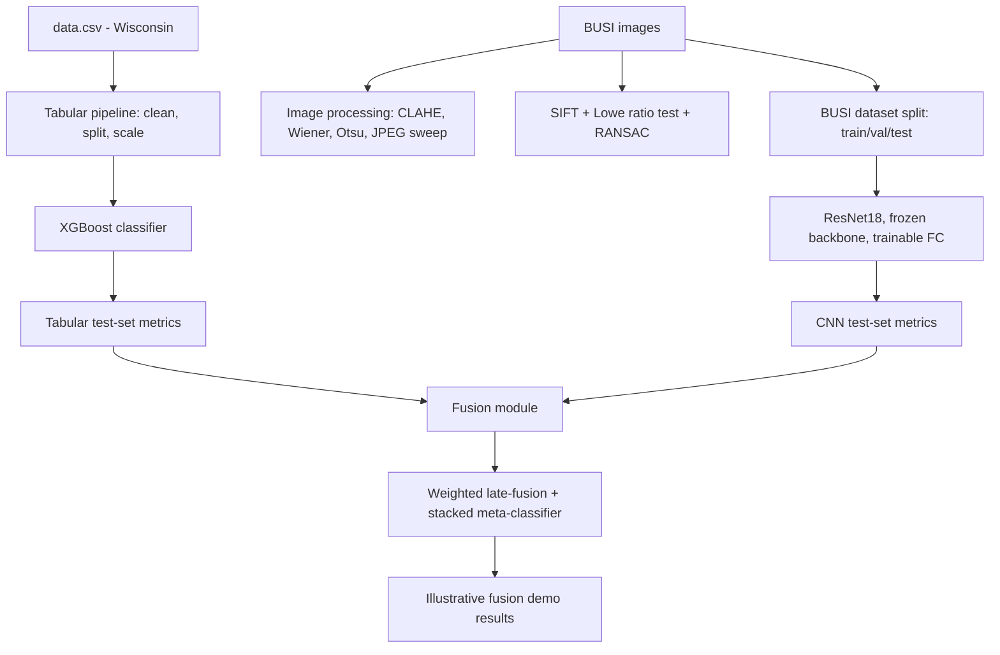

# Breast Cancer Multimodal Analysis — Tabular ML + Biomedical Image Processing + CNN Fusion

## 1. Problem Statement
Breast cancer diagnosis draws on multiple, separately-collected data modalities —
structured clinical/cytology measurements and medical images. This project builds,
evaluates, and (with an explicit caveat) fuses two independent pipelines:

1. A **tabular classifier** on the Wisconsin Diagnostic Breast Cancer dataset
   (30 numeric features derived from digitized FNA images).
2. An **imaging pipeline** on the BUSI (Breast Ultrasound Images) dataset covering
   classical biomedical image processing (enhancement, restoration, segmentation,
   compression), feature matching (SIFT + RANSAC), and a CNN classifier
   (transfer learning, CPU-only).

## 2. Motivation
Most student projects stop at "train a classifier, report accuracy." This project
instead demonstrates the **full biomedical image processing toolchain** end-to-end
with real, calculated metrics at every stage, а leakage-free ML pipeline, and an
honest treatment of multimodal fusion when the underlying datasets are not
patient-paired (a common, under-discussed real-world constraint).

## 3. Datasets

| Dataset | Used for | Size | Notes |
|---|---|---|---|
| Wisconsin Diagnostic Breast Cancer (`data.csv`) | Tabular ML | 569 rows × 30 features | Already small; CPU-trivial |
| BUSI (Breast Ultrasound Images) | Image processing, SIFT/RANSAC, CNN | ~780 images, 3 classes | Small enough for CPU-only work |

### Getting BUSI onto disk
1. Download **"Breast Ultrasound Images Dataset (BUSI)"** from Kaggle (search that
   exact name) or the original source (Al-Dhabyani et al., 2020).
2. Expected folder structure once extracted:
   ```
   data/BUSI/
     benign/
       benign (1).png
       benign (1)_mask.png
       benign (2).png
       benign (2)_mask.png
       ...
     malignant/
       malignant (1).png
       malignant (1)_mask.png
       ...
     normal/
       normal (1).png     <- no mask; normal has no lesion
       ...
   ```
3. `src/cnn_model.discover_busi()` walks each class folder, treats any file
   containing `_mask` as a **mask**, not an input image, and pairs a mask with its
   base image by filename when one exists (masks are only used for segmentation
   ground truth, never fed to the CNN as input).
4. Until you have the real dataset, `scripts/make_placeholder_data.py` generates a
   small SYNTHETIC placeholder BUSI folder (clearly labelled as such) so every
   script below runs without errors. **Delete/replace `data/BUSI/` with the real
   download before you report any results.**

### Tabular data
`scripts/make_placeholder_data.py` also writes a real copy of the Wisconsin dataset
(pulled from `sklearn.datasets.load_breast_cancer`, the same UCI source as the
typical Kaggle `data.csv`) to `data/data.csv`. If you already have your own
`data.csv` with `id`, `diagnosis` (M/B), and the 30 feature columns, just drop it
in `data/` to overwrite this one — no code changes needed.

## 4. System Architecture



## 5. Image Preprocessing / Enhancement / Restoration / Segmentation / Compression
All implemented in `src/image_processing.py`:
- **Enhancement**: CLAHE (`clipLimit=2.0`, `tileGridSize=8x8`) — chosen over global
  histogram equalization because ultrasound has strong local contrast variation;
  a global method over-amplifies noise while CLAHE boosts local (lesion-region)
  contrast without blowing out the whole image.
- **Restoration**: a KNOWN degradation model (Gaussian PSF blur + additive Gaussian
  noise) is applied, then reversed with **Wiener deconvolution**
  (`skimage.restoration.wiener`). This is the actual restoration technique, not
  Gaussian blur — Gaussian blur is only used here to construct the degraded input.
  Limitation stated openly: Wiener deconvolution assumes a known, spatially
  invariant PSF, which is an idealization of real ultrasound speckle.
- **Segmentation**: grayscale → blur → Otsu threshold → morphological open/close →
  largest-contour overlay. Dice/IoU computed against the BUSI ground-truth mask
  when available.
- **Compression**: a genuine JPEG quality sweep (95/75/50/25) — each level is
  encoded, saved, decoded back, and scored on file size, compression ratio, PSNR,
  and SSIM, producing a real results table and a quality-vs-PSNR/ratio plot.

## 6. SIFT + RANSAC
`src/sift_ransac.py`. Because BUSI images aren't natural image pairs, a controlled
transformed copy of one real image (known rotation+scale+translation) is created
so there is a valid geometric relationship to recover. SIFT detects keypoints,
BFMatcher + Lowe's ratio test filters descriptor matches, and
`cv2.findHomography(..., cv2.RANSAC, ...)` fits a homography and separates
inliers from outliers. Both raw and RANSAC-filtered matches are visualized and
counted.

## 7. CNN (Transfer Learning, CPU-only)
`src/cnn_model.py`. Pretrained ImageNet ResNet18, convolutional backbone **frozen**,
only the final `Linear` layer trained — this keeps training CPU-feasible (see
timing table below). Includes a proper train/val/test split, class-weighted loss
(BUSI classes are imbalanced), early stopping on validation loss, checkpointing,
and full test-set evaluation (accuracy, per-class precision/recall/F1, confusion
matrix) — never trained and evaluated on the same rows.

## 8. Tabular ML
`src/tabular_model.py`. Wisconsin data is split into train/test **before** any
fitting; the `StandardScaler` is fit on the training set only and applied
(not re-fit) to the test set. XGBoost is trained on the training split and
evaluated strictly on the held-out test split — the earlier
`X.iloc[:1]`-on-training-data bug is gone.

## 9. Fusion — and its honest limitation
`src/fusion.py`. **Wisconsin and BUSI have no shared patients** — there is no
ground truth linking a specific tabular row to a specific ultrasound image. This
project does not pretend otherwise. It:
1. Reports each branch's real, independently-evaluated test metrics (the numbers
   that belong in your main results table).
2. Implements the actual fusion mechanism — weighted late-fusion
   (`P_final = w1*P_tab + w2*P_img`) and a stacked logistic-regression
   meta-classifier — exactly as it would run on paired patient data.
3. Demonstrates that mechanism on a clearly-labelled **illustrative simulated
   pairing** (test-set tabular cases randomly paired with test-set image cases of
   the matching label), so the fusion code is verified to work, without claiming
   a clinical result that the data can't support.

## 10. Evaluation Metrics
Every component reports accuracy, precision, recall, F1, and (where applicable)
ROC-AUC — never accuracy alone. Confusion matrices, ROC curve, and PR curve are
all saved as figures.

## 11. Results
See `outputs/metrics/final_results_table.csv` and `outputs/metrics/all_metrics.json`
after running `scripts/run_all.py` — these are the **real, computed** numbers from
your actual run (they will differ from any numbers shown during development,
since those used a small synthetic placeholder BUSI set and, in one sandboxed
test run, randomly-initialized CNN weights instead of downloaded ImageNet
weights). All figures land in `outputs/figures/`.

## 12. Limitations
- Wisconsin and BUSI are unpaired datasets — see Section 9. Fusion results are
  illustrative, not a validated clinical claim.
- Wiener restoration assumes a known, spatially-invariant PSF — a simplification
  of real ultrasound degradation.
- BUSI is a modest-sized dataset (~780 images) — the frozen-backbone CNN is
  appropriately sized for this, but won't match large-scale fully fine-tuned
  models.
- Segmentation via Otsu + morphology is a classical baseline, not a learned
  segmentation model (e.g., U-Net) — a natural extension.

## 13. Future Improvements
- Fine-tune more ResNet layers if a GPU becomes available.
- Add a learned segmentation model (U-Net) and compare against the Otsu baseline.
- If a genuinely paired multimodal dataset becomes available, replace the
  illustrative fusion demo with a real per-patient fusion evaluation.

## 14. How to Run

```bash
cd project
pip install -r requirements.txt

# one-time: generate placeholder data (or place your real data.csv / BUSI folder
# in data/ first, matching the structure in Section 3)
python scripts/make_placeholder_data.py

# run everything (stages 3-9): image processing, SIFT/RANSAC, CNN, tabular ML, fusion
python scripts/run_all.py
```

Outputs: `outputs/figures/`, `outputs/metrics/`, `models/`.

### Approximate CPU timings (small placeholder data; scale up with real BUSI)
| Step | Approx. time on CPU |
|---|---|
| Image processing (enhancement/restoration/segmentation/compression) on 1 image | < 1 second |
| SIFT + RANSAC on one image pair | < 1 second |
| CNN training, 6 epochs, frozen backbone, ~75 images | ~5–15 seconds |
| CNN training, 6 epochs, frozen backbone, full BUSI (~780 images) | ~1–3 minutes |
| Tabular XGBoost train+eval (569 rows) | < 2 seconds |
| Fusion demo | < 1 second |

If full-BUSI CNN training feels slow on your machine: drop `IMG_SIZE` in
`src/cnn_model.py` from 160 to 128, or reduce `batch_size`/`epochs` in
`scripts/run_all.py` — the frozen backbone means there's very little to speed up
elsewhere.
